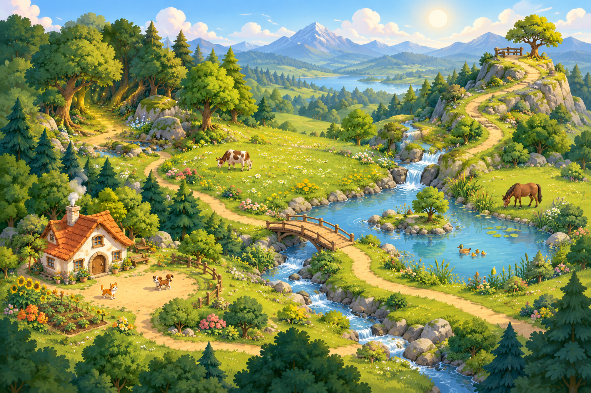
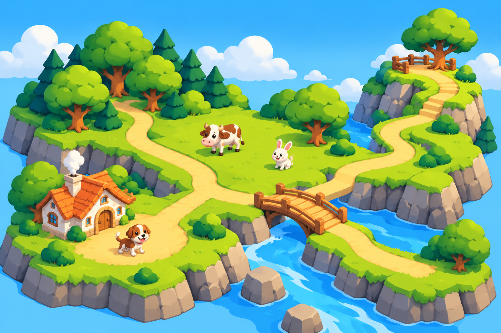

# Animal Valley Map Concept Explorations

Status: work in progress; visual direction is not final.

## Version 1 — storybook landscape

The first image explores a detailed, storybook-like animal world with a home
clearing, woodland, meadow, stream, bridge and hilltop lookout.

## Version 2 — simplified 2.5D game-map direction

The second image tests a simpler, more game-like direction: large land regions,
broader paths, fewer landmarks and gently dimensional terrain with comic-like
shapes. It is still an illustration, not a clickable map or a set of reusable
production assets. The image was generated with Codex ImageGen on 29 October
2026; verify applicable usage rights before product use.

## What remains open

Neither image is an approved map layout or production asset. Locations, labels,
mission placement, navigation behavior, visual details and final art remain to
be designed. Do not infer that every pictured animal or location belongs in the
MVP. The first image's source and usage rights have not yet been verified.

The intended implementation should not depend on one detailed flattened image.
After the world layout is agreed, build it from a simple background, a small set
of reusable landmarks, clearly defined interactive region or mission nodes, and
a navigable path layer. This keeps the map easier to adapt for phone, tablet,
desktop and future content.

## Design questions

- Which few locations make the world easy for a child aged 6–8 to understand?
- How should the map communicate where a mission is available without adding
  unnecessary visual clutter?
- Which visual direction is clear, appealing and practical to implement?
- What is the simplest keyboard, touch and accessible navigation model?
- How should the layout adapt to phone, tablet and desktop sizes?

Keep this document and the existing MVP development plan aligned as the design
evolves. These concepts do not authorize implementation of extra missions,
regions or subjects.
